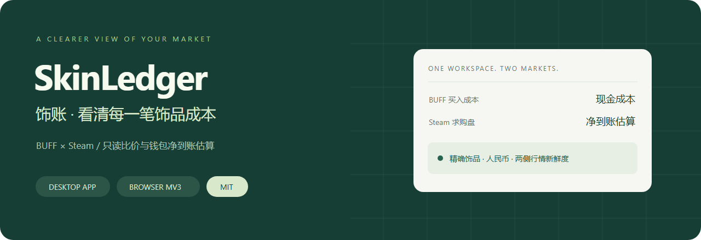
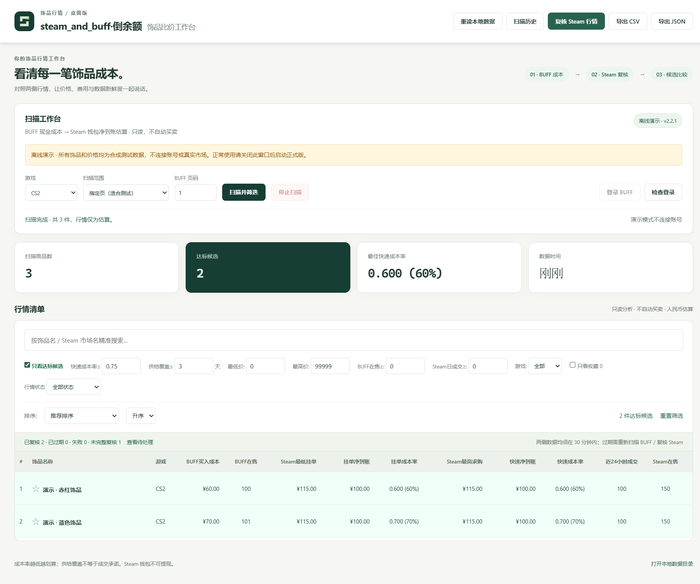
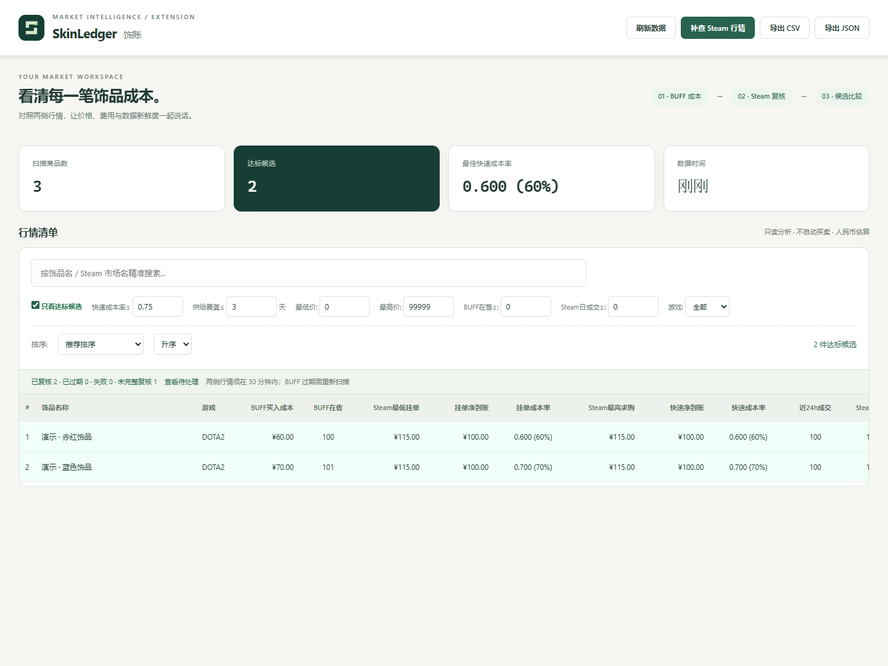
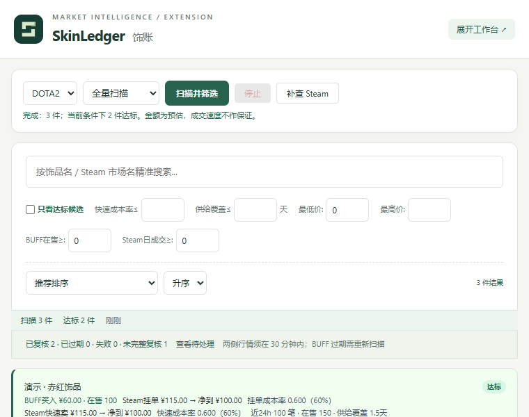

<div align="center">



# steam_and_buff·倒余额

**把 BUFF 买入成本与 Steam 钱包净到账放在同一张工作台。**

Steam 余额 · BUFF 挂刀 · 饰品比价 · 倒余额成本 · 净到账估算

[](https://github.com/lordfine/steam_and_buff/releases/latest)
[](https://github.com/lordfine/steam_and_buff/actions/workflows/ci.yml)
[](LICENSE)
[](#桌面版)
[](#浏览器插件版)

[快速开始](#快速开始) · [两种版本](#两种版本一套计算口径) · [界面预览](#界面预览) · [开发](#开发与验证)

</div>

## 看见价格，也看见证据

steam_and_buff·倒余额是一款面向中文用户的 **Steam 余额、BUFF 挂刀与倒余额成本分析工具**，支持 CS2 / DOTA2 饰品比价、Steam 钱包净到账估算、人民币行情复核和候选筛选，提供本地桌面版与浏览器插件版。项目本地优先、只读。它不自动买卖，不索取密码，不提供钱包提现，也不承诺利润或成交时间。

| 你想知道 | 工作台提供什么 |
|---|---|
| 买入花多少现金？ | BUFF 最低在售价格、在售数量与采集时间 |
| Steam 能换得多少钱包余额？ | 挂单口径与最高求购口径的净到账估算，分开展示 |
| 哪些值得进一步检查？ | 成本率、成交量、在售数量、供给覆盖与保守候选筛选 |
| 数据能否用于比较？ | 已复核、过期、失败、未完整复核状态；失败不会悄悄隐藏 |
| 如何复盘和留存？ | 搜索、筛选、CSV / JSON 导出；桌面版额外提供收藏和历史恢复 |

## 快速开始

从 [版本下载](https://github.com/lordfine/steam_and_buff/releases/latest) 下载对应文件，不需要接口密钥。

### 桌面版

1. 下载 `steam_and_buff-2.2.1-windows-x64.exe`，双击运行，无需安装 Node.js。
2. 点击 **登录 BUFF**，在应用独立窗口内自行登录，再点击 **检查登录**。
3. 选择 CS2 / DOTA2，建议先选 **指定页**，点击 **扫描并筛选**。
4. 扫描后自动限速复核前 20 件预选候选；其余可通过 **复核 Steam 行情** 分批处理。
5. 点击饰品名称查看证据与失败原因，按需收藏或导出。

> 当前提供 Windows x64 便携包，暂未代码签名。升级前完全退出旧版。扫描结果、收藏与登录会话保存在本机。源码用户也可双击 `启动本地应用.cmd`。

### 浏览器插件版

1. 下载 `steam_and_buff-2.2.1-extension.zip`，**先解压**到一个固定目录。
2. Chrome / Edge 打开扩展管理页，开启开发者模式，选择 **加载已解压的扩展程序**，选中含 `manifest.json` 的目录。
3. 在同一个浏览器配置中登录 BUFF。首次安装或升级新增权限时，由浏览器确认授权。
4. 点击steam_and_buff·倒余额图标，在弹窗中扫描；**BUFF 当前页**模式使用当前 BUFF 标签页的页码。
5. 点击 **展开工作台** 打开大屏面板，筛选、复核并导出。

> 插件目前以手动加载方式分发，尚未上架扩展商店。以 Chrome 120+ / Edge Chromium 120+ 为最低 API 基线；当前自动测试覆盖 Playwright Chromium。不会读取其他浏览器配置。

## 两种版本，一套计算口径

| 能力 | 桌面版 | 插件版 |
|---|:---:|:---:|
| CS2 / DOTA2、BUFF 扫描、Steam 复核 | ✓ | ✓ |
| 新旧 Steam 商品页兼容、严格人民币校验 | ✓ | ✓ |
| 两侧 30 分钟新鲜度、错误提示与重试 | ✓ | ✓ |
| 搜索、筛选、CSV / JSON 导出 | ✓ | ✓（大屏面板） |
| 统一墨绿 / 浅色工作台 | ✓ | ✓ |
| 收藏、单件详情、最近 5 次扫描历史 | ✓ | — |
| 独立离线演示模式 | ✓ | 测试脚本使用合成数据 |
| 登录会话 | 应用独立会话 | 当前浏览器配置 |

两端共用 `background.js` 与 `lib/`，不自动同步数据或登录。网页插件不是独立网站，不需要额外部署后端。

## 界面预览

下列截图来自隔离测试环境，**商品和价格均为合成数据，不是交易建议**。

### 桌面工作台



### 浏览器工作台



<details>
<summary>查看插件弹窗</summary>



</details>

## 指标与边界

- **净到账估算**：使用统一估算费率计算；实际手续费、最小计费和最终成交以 Steam 确认为准。
- **成本率**：`BUFF 买入成本 ÷ Steam 净到账估算`，越低表示同额钱包余额所需现金越少，不等于现金利润率。
- **供给覆盖**：`Steam 在售数 ÷ 近 24 小时 成交量`，是大盘流动性参考，不保证某件饰品多久能卖出。
- 默认候选要求成本率 ≤ 0.75、供给覆盖 ≤ 3 天，且 BUFF / Steam 两侧有效时间均在 30 分钟内。
- Steam 只返回外币、相似饰品或缺少成交量时，不伪造人民币报价、不将其计为有效候选。
- “查看待处理”会清除价格等限制以展示更多结果。Steam 复核只更新 Steam；BUFF 成本过期须重新扫描。
- Steam Wallet 不可提现；交易限制、冷却、手续费及平台规则仍适用。本项目与 Valve / Steam / BUFF 无隶属或背书关系。

## Steam 复核为什么可能失败？

2.2 系列已将桌面版的新版页面兼容修复带到插件版：优先解析精确匹配的人民币结构化数据，需要时采用 Steam 自身的经典市场页面偏好获取求购盘 ID，再请求人民币行情。两端都不会把外币默认报价当成人民币。

网络、HTTP 429 限流、登录失效或平台再次改版仍可能造成失败。先查看具体错误，等待后重试；不要通过提高请求频率处理限流。缺少成交量的商品保持“未完整复核”。

## 开发与验证

Node.js 22+；桌面开发测试建议 Windows。

```sh
npm ci
npm run demo             # 独立离线演示，不连接账号
npm start                # 桌面正式模式
npm run dev              # 桌面开发者工具
npm run build:extension  # 生成可加载目录 + ZIP
npm run pack             # Windows 解压即用目录
npm run dist             # Windows 单文件便携包
```

```sh
npm test
npx playwright install chromium
npm run test:extension   # 真正 MV3 浏览器，合成行情、临时配置
npm run test:e2e         # 真正 Electron 窗口，临时配置
node tests/portable-smoke.js  # 构建后检查便携包
```

默认测试不需要真实账号。可选设置 `SKINLEDGER_LIVE_TEST=1`，让插件测试额外对公开 Steam 商品页进行一次只读兼容检查。接口可用性不由本项目保证。

```text
background.js          两端共享的扫描与复核管线
lib/                   计算、数据口径、存储与 Steam 解析
lib/extension-transport.js  MV3 请求兼容适配
desktop/               Electron 宿主、界面、持久化与会话隔离
popup.* / dashboard.*  MV3 弹窗与完整工作台
ui/                    共享设计令牌、品牌与状态展示
build/                 白名单打包、启动与品牌资源生成
tests/                 纯逻辑、桌面后端、MV3 与 Electron 验收
docs/                  术语决策、品牌规范和界面截图
```

插件打包采用显式文件白名单，不含测试、日志、账号数据、备份或开发环境配置。安装包放在 版本发布页，不进入源码历史。

## 本地数据与隐私

桌面正式数据沿用 `%APPDATA%/steam-balance-desktop/`，演示数据为 `%APPDATA%/steam-balance-demo/`。数据文件原子写入，并保留上一份备份。不要公开分享整个目录，其中可能包含登录会话。

插件数据保存在当前扩展的本地存储中。新增的 DNR 权限只对**本扩展发出的 Steam 商品页请求**附加页面偏好，不读取认证 Cookie，不写入浏览器 Cookie 存储，不改变普通网页请求。

[安全与隐私](SECURITY.md) · [参与开发](CONTRIBUTING.md) · [更新日志](CHANGELOG.md) · [术语表](GLOSSARY.md)

## 许可

[MIT](LICENSE) © 2026 lordfine。第三方依赖与平台商标遵循各自许可及权利归属。
